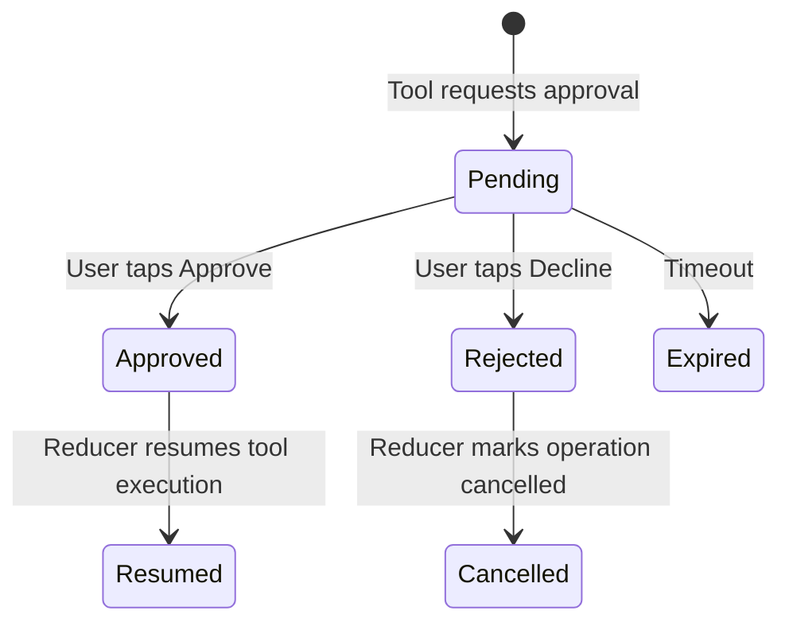

# Agent Activity Hierarchy Specification

## 1. Overview & Core Invariants

In modern agentic chat applications, agent reasoning and tool executions must not clutter the conversation flow. `AgentChatSDK` enforces a quiet, user-controlled disclosure model inspired by ChatGPT's `Worked for...` and macOS/iOS system design standards.

### Core Invariants
1. **Collapsed by Default**: All agent runs begin in a collapsed state (`isExpanded = false`). They remain collapsed both during active execution and after completion.
2. **User Disclosure Preservation**: The SDK reducer never overrides user intent. If a user expands an activity view to inspect progress, incoming streaming tokens or tool events will not collapse it. If a user leaves it collapsed, events will not force it open.
3. **Approval Visibility**: Action-required tool calls (e.g. database deletions, payment confirmations) are surfaced outside the collapsed disclosure tree via dedicated `AgentApprovalRequestCard` elements.
4. **Final Results Outside**: The final answer text and rich result cards (charts, maps, canvas diffs) are rendered outside the activity tree directly in the message body.

---

## 2. The Three-Level Hierarchy

```
Level 0: Run Header (e.g., "Working for 14s..." or "Worked for 1m 24s")
  │
  ├── Level 1: Stage / Group (e.g., "Searching documentation")
  │     │
  │     ├── Level 2: Operation (e.g., "Querying developer.apple.com") [Status: Success, Duration: 420ms]
  │     │     └── Sources / Domains: [developer.apple.com] [github.com]
  │     └── Level 2: Operation (e.g., "Parsing API signatures") [Status: Success, Duration: 180ms]
  │
  └── Level 1: Stage / Group (e.g., "Synthesizing code example")
        └── Level 2: Operation (e.g., "Verifying Swift 6 concurrency") [Status: Success, Duration: 310ms]
```

### Level 0: Run Header
- While running: Displays a subtle thinking spinner (`AgentThinkingIndicator`) and an active elapsed timer: `Working for {duration}`.
- When completed: Displays a muted SF Symbol checkmark and total run time: `Worked for {duration}`.
- Tap gesture toggles `isExpanded`.

### Level 1: Activity Groups
- Groups represent high-level logical phases emitted by the orchestrator (e.g., `Planning`, `Web Research`, `Code Analysis`).
- Each group has its own sub-disclosure indicator, title, and aggregated status (`running`, `completed`, `failed`).

### Level 2: Individual Operations
- Atomic tool invocations with granular metadata:
  - Operation title and tool identifier.
  - Duration badge (e.g., `350ms`).
  - Source domain chips (`[apple.com]`, `[github.com]`).
  - Inspector trigger button (magnifying glass) to open the redacted technical JSON payload.

---

## 3. Approval Flow & State Machine

When a tool requires human authorization:
1. Orchestrator emits `AgentChatStreamEvent.approvalRequested(request)`.
2. The reducer adds the request to `ChatMessage.approvalRequests`.
3. `AgentApprovalRequestCard` renders directly in the transcript.
4. User taps **Approve** or **Decline**.
5. The session dispatches `handleAction(.approve(id))` or `handleAction(.reject(id))` to resume or cancel execution.


