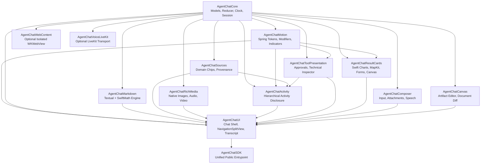
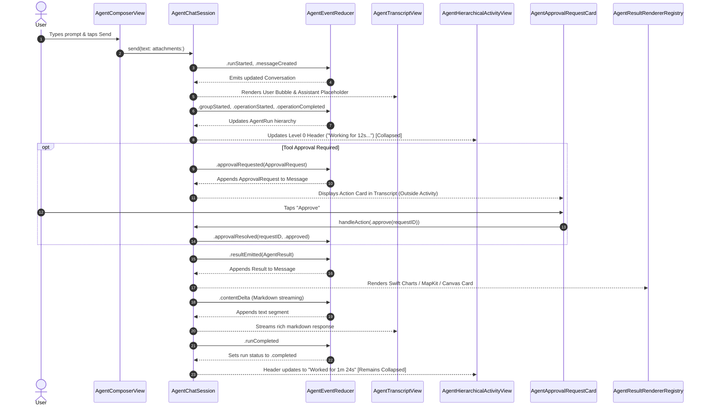

# AgentChatSDK Architecture Specification (iOS 27.0+)

## 1. System Overview & Modular DAG

`AgentChatSDK` is organized as a strict directed acyclic graph (DAG) of specialized modules under Swift Package Manager targeting `iOS 27.0+`. The architecture enforces single-responsibility boundaries, pure-Swift core models, and zero direct web view dependencies in the standard rendering pipeline.

---

## 2. State Ownership & No-Singleton Guarantees

In legacy implementations, global singletons such as `AgentActivityStore.shared` and `ToolExecutionDemoStore.shared` introduced race conditions, leaky state across test cases, and tight coupling with specific views.

`AgentChatSDK` enforces complete instance-level scoping:
1. **`AgentChatSession` as Scoped Owner**: Each chat window or view hierarchy instantiates an observable `@Observable final class AgentChatSession`. It holds its own conversations, active message drafts, configuration, and event stream subscriptions.
2. **Deterministic Reducer**: State transitions are performed through `AgentEventReducer.reduce(conversation:event:)`, a pure function returning a mutated conversation without side effects.
3. **No Hidden Observers**: Activity runs, tool executions, and approval cards are stored directly in `ChatMessage.agentRun` and `ChatMessage.approvalRequests`. There are no global notification centers, singletons, or background stores.

---

## 3. Event Flow & Life Cycle

The following diagram illustrates how user input flows from the native composer into the session, driving the virtual clock and reducer, and updating native UI components:

---

## 4. Action & Result Correlation

To ensure reliable, typed interaction without loose string dictionary conversions:
- **`ApprovalRequest`**: Uses stable `UUID` identifiers (`requestID`). Actions dispatch `AgentChatUserAction.approve(requestID)` or `.reject(requestID)`.
- **`AgentResult`**: Every tool output is wrapped in an `AgentResult` with a stable `resultID`, a typed `AgentResultKind` (e.g., `.chart`, `.map`, `.form`, `.canvasDiff`), and a typed payload conforming to `AnySendable`.
- **Action Callbacks**: Actions dispatched from interactive result cards (such as form adjustments or code editor approvals) carry `correlationRunID` and `parentMessageID` ensuring strict causal traceability in multi-agent workflows.
